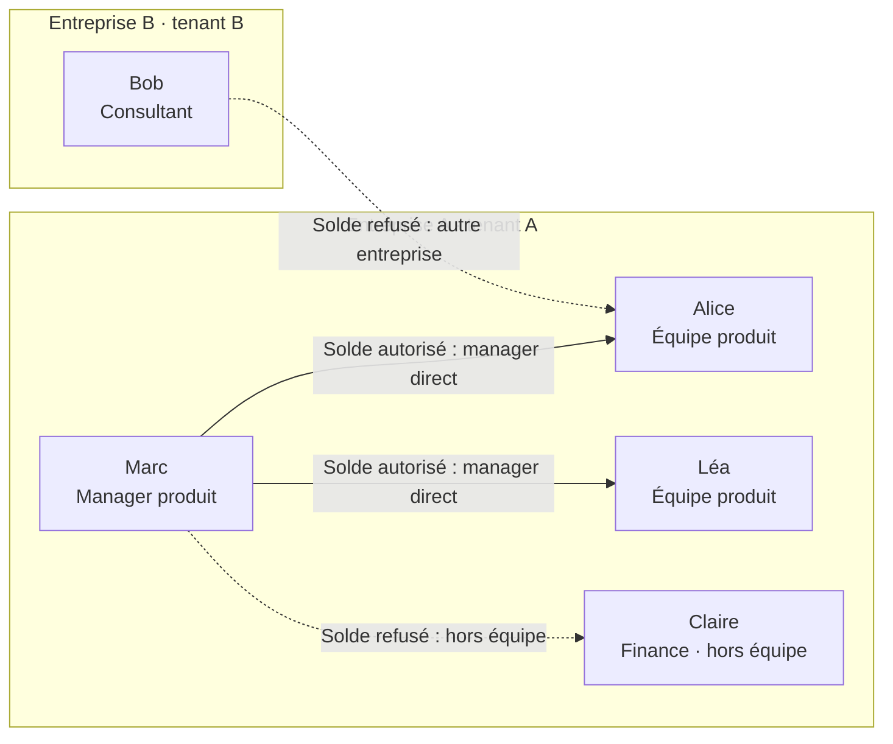
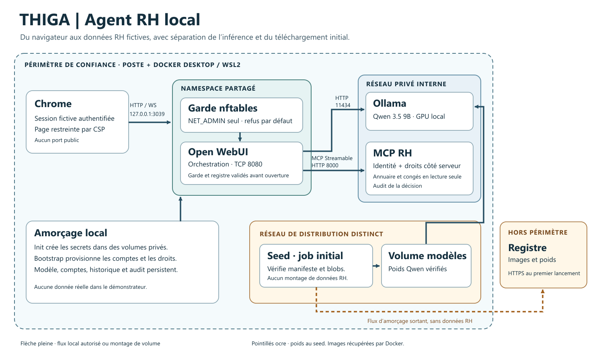

# THIGA · Agent RH local

Ce projet est un **démonstrateur local d'assistant RH conversationnel**, sur des données entièrement fictives. Une personne formule sa demande en langage naturel ; le modèle Qwen, exécuté localement, peut proposer une recherche d'employé ou une consultation de solde via deux outils MCP en lecture seule. **L'autorisation n'est jamais décidée par le modèle** : le serveur RH retrouve l'identité de la session, limite l'annuaire à l'entreprise concernée, puis vérifie séparément les droits d'accès au solde. L'objectif est de montrer pourquoi **pouvoir retrouver un collègue ne signifie pas pouvoir lire ses congés**.

### Cas métier : deux entreprises, cinq salariés fictifs

Le scénario oppose deux entreprises isolées (ou *tenants*). Dans l'entreprise A, Marc encadre directement Alice et Léa, tandis que Claire appartient au service finance, hors de son équipe. Bob appartient à l'entreprise B. Les cinq personnes existent dans les données RH synthétiques ; **Marc, Alice et Bob** disposent de comptes utilisateurs WebUI pour les essais du démonstrateur.



**Lecture des flèches :** de la personne qui demande vers celle dont elle souhaite consulter le **solde de congés**. Les flèches continues illustrent des accès autorisés ; les pointillées, des refus. Chaque personne peut aussi consulter **son propre solde** (non dessiné pour éviter les boucles). Le diagramme montre les relations déterminantes ; la matrice ci-dessous couvre toutes les combinaisons d'acteur et de cible.

| Demandeur ↓ / Cible → | Marc | Alice | Léa | Claire | Bob |
|---|:---:|:---:|:---:|:---:|:---:|
| **Marc** | R + S | R + S | R + S | R | — |
| **Alice** | R | R + S | R | R | — |
| **Léa** | R | R | R + S | R | — |
| **Claire** | R | R | R | R + S | — |
| **Bob** | — | — | — | — | R + S |

**R** = recherche exacte de la personne dans l'annuaire professionnel de la même entreprise (attributs limités, **sans solde**). **S** = consultation de son solde via MCP, autorisée pour soi-même ou un subordonné direct. **—** = cible extérieure à l'entreprise : ni résultat d'annuaire ni accès au solde. La matrice décrit **la politique implémentée dans le code**, pas 25 parcours de bout en bout validés indépendamment.

**Trois parcours représentatifs qualifiés :** Marc → Alice renvoie **12 jours** via MCP ; Marc → Claire est refusé malgré sa présence dans l'annuaire ; Bob → Alice est refusé à la frontière entre entreprises. Un refus côté MCP n'implique pas que le modèle choisira toujours correctement l'outil ou la cible. Voir [le code des règles RH](demonstrateur/fixtures.py), [les flux d'identité](docs/ARCHITECTURE.md) et [la portée des tests](docs/QUALIFICATION.md).

## Architecture



**Open WebUI** gère les sessions et les conversations. **Ollama** exécute Qwen3.5 9B Q4_K_M localement. WebUI transmet les appels proposés par le modèle au **serveur MCP Python**, via Streamable HTTP. Le serveur contrôle la connexion de service, résout l’identité de session et applique les règles RH. Le modèle ne peut fournir que les paramètres de recherche ou la cible de la consultation.

| Choix | Bénéfice et compromis |
|---|---|
| MCP natif et deux outils en lecture seule | Frontière RH et audit centralisés. Le solde dépend de l’identité authentifiée et de la relation hiérarchique. |
| Inférence locale et versions épinglées | Pas de fournisseur distant pendant l’inférence. Le GPU et l’accès initial aux registres restent nécessaires. |
| Docker Compose avec garde réseau | Publication sur `127.0.0.1:3039` et sorties WebUI filtrées. Le téléchargement initial des poids utilise un réseau séparé. |
| Secrets et état dans des volumes dédiés | Initialisation autonome et reprise de l’état. L’administrateur Docker reste dans la frontière de confiance. |

Voir [les flux et les autorisations](docs/ARCHITECTURE.md), [la provenance des dépendances](docs/BUILD.md) et [la trajectoire de mise en production](docs/PRODUCTION.md).

**Décisions détaillées :** [20 dossiers d'arbitrage et leurs compromis](docs/DECISIONS.md) · [catalogue des 173 unités documentaires](docs/decisions/CATALOGUE-COMPLET.md).  
**Second schéma :** [architecture cible d'industrialisation avec Kubernetes — proposition non déployée](docs/ARCHITECTURE-CIBLE-KUBERNETES.md).

## Installation pour les destinataires du paquet de remise

**Le dépôt public contient les sources. Il faut disposer du ZIP technique remis au jury pour reconstruire les images de cette version.** Les deux bases OCI exactes sont dans ce ZIP. Le dépôt conserve les recettes et les digests. La redistribution publique des bases n’a pas été validée.

Le plus simple consiste à extraire le ZIP technique dans un dossier dédié, puis à suivre son Compose. Si vous avez déjà cloné le dépôt et disposez du ZIP autorisé, vous pouvez restaurer ses bases OCI dans la copie locale avec Python 3.11 ou supérieur, depuis la racine du dépôt.

```powershell
python tools/restaurer-oci.py "<chemin-vers-le-ZIP-de-remise-ou-le-ZIP-technique>"
cd demonstrateur
docker compose up --build -d
```

Le script vérifie le SHA-256 de l’archive, le manifeste interne et l’intégrité des sources locales avant d’écrire les deux bases. Sur le poste de référence, Docker Desktop utilisait Linux amd64 sous WSL2, Docker 29.9.2, Compose 5.6.1 et BuildKit 0.34.0. Prévoir un GPU NVIDIA accessible à Docker avec au moins **9 216 Mio de VRAM libre**, **11 Gio** de mémoire WSL disponible et **25 Gio** de disque libre. Le port **3039**, le projet Compose et ses trois sous-réseaux doivent être disponibles. Docker peut devoir obtenir les images Open WebUI et Ollama. Le seed acquiert environ **6,55 Go** de poids Qwen et en vérifie l’identité.

Contrôler `docker compose ps -a`. Attendre les codes 0 de `init`, `seed` et `bootstrap` et l’état sain de `webui-guard`, `ollama`, `webui` et `mcp`. Ouvrir [Open WebUI sur localhost](http://127.0.0.1:3039/). Sous Windows, `pwsh -NoProfile -File .\Open-Marc.ps1` fournit l’accès local au compte fictif de démonstration. Utiliser le script en privé. Dans un nouveau chat sous Marc, sélectionner Qwen et activer **THIGA RH** dans **Intégrations → Outils**. Contrôler les décisions via `docker compose logs --since 15m mcp`. Pour arrêter en conservant les volumes, utiliser `docker compose stop`.

## Preuves et limites

Le démarrage Compose de la version scellée a réussi en **167,266 s** sur volumes vierges, avec les deux images tierces déjà en cache. Les résultats Chrome et MCP couvrent les scénarios fictifs ci-dessus. Le contrôle HTTP s’appuyait sur le harnais. Le confinement Internet et la reprise après incident restent partiellement qualifiés. Le garde protège le namespace WebUI, tandis que le navigateur hôte est une frontière distincte. L’essai d’injection indirecte couvre un scénario. Le modèle peut aussi terminer après la recherche sans appeler l’outil de solde. [Portée des résultats](docs/QUALIFICATION.md)

## Assistance IA et composants tiers

### Conception, pilotage et arbitrages

Ce démonstrateur a été mené comme un **projet de conception, d'intégration et de qualification d'un système IA local**, et non comme une simple démonstration d'interface conversationnelle. Le travail de l'auteur a notamment porté sur le cadrage du cas RH, la définition des acteurs et des habilitations, l'analyse des risques, les choix d'architecture, la comparaison des solutions, la priorisation des remédiations et l'évaluation critique des résultats. Les décisions ont été confrontées à leurs compromis et aux preuves disponibles, y compris lorsque des essais se sont soldés par des échecs ou des résultats partiels.

Parmi les choix structurants : séparation de l'identité authentifiée et de la cible demandée ; autorisations déterministes dans MCP plutôt que dans le LLM ; intégration MCP native ; inférence locale ; confinement réseau dédié ; gestion des états et de la révocation ; versionnement et vérification des dépendances ; démarrage Compose ; qualification sur parcours autorisés, interdits et adversariaux. Le [registre des décisions](docs/DECISIONS.md) documente les alternatives, motivations et limites de ces arbitrages. Les [résultats de qualification](docs/QUALIFICATION.md) distinguent les constats bornés des points encore partiels.

### Usage de l'assistance IA

**ChatGPT et Codex ont constitué des moyens de travail importants** pour explorer des options, challenger des hypothèses, assister la rédaction de spécifications, produire et modifier du code, préparer les essais, analyser les anomalies et structurer la documentation. Certaines implémentations et remédiations ont été réalisées avec une assistance IA substantielle ; le projet ne revendique donc pas une écriture intégralement manuelle de ses sources.

L'auteur a assuré le **pilotage du périmètre, des priorités et des arbitrages**, ainsi que la revue des propositions et l'acceptation ou le rejet des résultats à la lumière des essais disponibles. Une proposition ou une analyse émise par une IA n'était pas, à elle seule, considérée comme une preuve de fonctionnement. Les tests mentionnés sont ceux consignés dans la qualification de la livraison corrigée : **aucune campagne Docker nouvelle n'a été exécutée pour la publication GitHub ni pour cette révision documentaire**.

### Composants et licences

**Open WebUI**, **Ollama**, **Qwen**, le **SDK Python MCP**, **Python** et **Debian** sont des technologies tierces : leur utilisation ou adaptation ne constitue pas une revendication de création de ces composants. Les crédits, versions et licences identifiés figurent dans les [notices de composants tiers](THIRD-PARTY-NOTICES.md). Les fichiers dérivés d'Open WebUI y sont explicitement signalés. Les données RH sont synthétiques. **Aucune licence globale n'est déclarée pour les sources propres au projet** ; l'absence d'une telle déclaration ne vaut pas permission générale de réutilisation.
