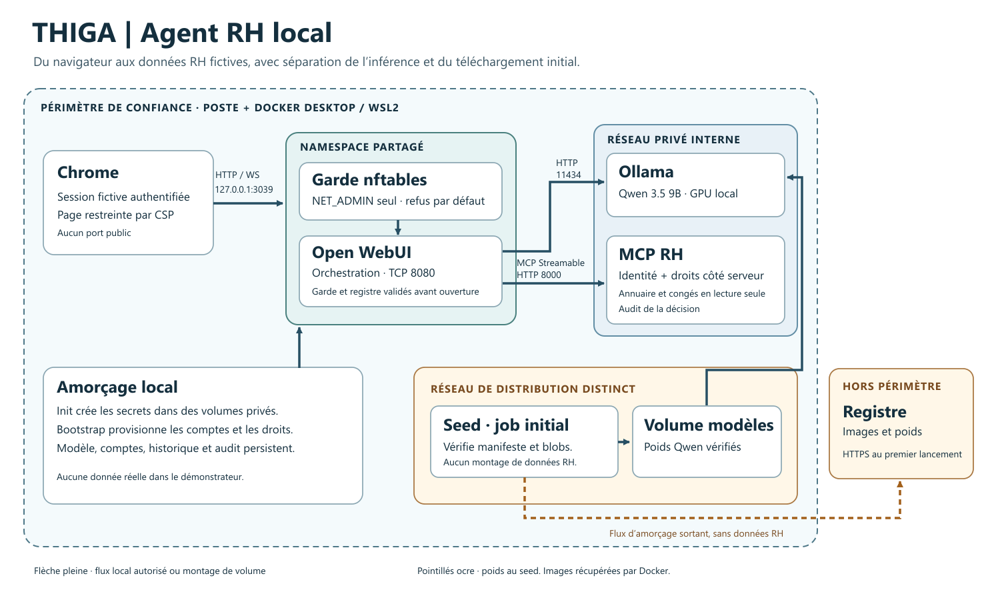

# THIGA · Agent RH local

Démonstrateur d’un assistant RH qui recherche un salarié fictif et consulte son solde de congés. Le cas montre une distinction importante : retrouver un nom dans l’annuaire de son entreprise ne donne pas accès à son solde.

- **Marc → Alice** · Le solde fictif de **12 jours** provient de l’outil RH.
- **Marc → Claire** · L’annuaire peut trouver Claire. Le serveur refuse le solde, car elle ne relève pas de Marc.
- **Bob → Alice** · Le serveur refuse l’accès entre deux entreprises.

## Architecture



**Open WebUI** gère les sessions et les conversations. **Ollama** exécute Qwen3.5 9B Q4_K_M localement. WebUI transmet les appels proposés par le modèle au **serveur MCP Python**, via Streamable HTTP. Le serveur contrôle la connexion de service, résout l’identité de session et applique les règles RH. Le modèle ne peut fournir que les paramètres de recherche ou la cible de la consultation.

| Choix | Bénéfice et compromis |
|---|---|
| MCP natif et deux outils en lecture seule | Frontière RH et audit centralisés. Le solde dépend de l’identité authentifiée et de la relation hiérarchique. |
| Inférence locale et versions épinglées | Pas de fournisseur distant pendant l’inférence. Le GPU et l’accès initial aux registres restent nécessaires. |
| Docker Compose avec garde réseau | Publication sur `127.0.0.1:3039` et sorties WebUI filtrées. Le téléchargement initial des poids utilise un réseau séparé. |
| Secrets et état dans des volumes dédiés | Initialisation autonome et reprise de l’état. L’administrateur Docker reste dans la frontière de confiance. |

Voir [les flux et les autorisations](docs/ARCHITECTURE.md), [la provenance des dépendances](docs/BUILD.md) et [la trajectoire de mise en production](docs/PRODUCTION.md).

## Installation pour les destinataires du paquet de remise

**Le dépôt public contient les sources. Il faut disposer du ZIP technique remis au jury pour reconstruire les images de cette version.** Les deux bases OCI exactes sont dans ce ZIP. Le dépôt conserve les recettes et les digests. La redistribution publique des bases n’a pas été validée.

Le plus simple consiste à extraire le ZIP technique dans un dossier dédié, puis à suivre son Compose. Si vous avez déjà cloné le dépôt et disposez du ZIP autorisé, vous pouvez restaurer ses bases OCI dans la copie locale avec Python 3.11 ou supérieur, depuis la racine du dépôt.

```powershell
python tools/restaurer-oci.py "<chemin-vers-le-ZIP-de-remise-ou-le-ZIP-technique>"
cd demonstrateur
docker compose up --build -d
```

Le script vérifie le SHA-256 de l’archive, le manifeste interne et l’intégrité des sources locales avant d’écrire les deux bases. Sur le poste de référence, Docker Desktop utilisait Linux amd64 sous WSL2, Docker 29.9.2, Compose 5.6.1 et BuildKit 0.34.0. Prévoir un GPU NVIDIA accessible à Docker avec au moins **9 216 Mio de VRAM libre**, **11 Gio** de mémoire WSL disponible et **25 Gio** de disque libre. Le port **3039**, le projet Compose et ses trois sous-réseaux doivent être disponibles. Docker peut devoir obtenir les images Open WebUI et Ollama. Le seed acquiert environ **6,55 Go** de poids Qwen et en vérifie l’identité.

Contrôler `docker compose ps -a`. Attendre les codes 0 de `init`, `seed` et `bootstrap` et l’état sain de `webui-guard`, `ollama`, `webui` et `mcp`. Ouvrir [Open WebUI sur localhost](http://127.0.0.1:3039/). Sous Windows, `pwsh -NoProfile -File .\Open-Marc.ps1` fournit l’accès local au compte fictif de démonstration. Utiliser le script en privé. Dans un nouveau chat sous Marc, sélectionner Qwen et activer **THIGA RH** dans **Intégrations → Outils**. Contrôler les décisions via `docker compose logs --since 15m mcp`. Pour arrêter en conservant les volumes, utiliser `docker compose stop`.

## Preuves et limites

Le démarrage Compose de la version scellée a réussi en **167,266 s** sur volumes vierges, avec les deux images tierces déjà en cache. Les résultats Chrome et MCP couvrent les scénarios fictifs ci-dessus. Le contrôle HTTP s’appuyait sur le harnais. Le confinement Internet et la reprise après incident restent partiellement qualifiés. Le garde protège le namespace WebUI, tandis que le navigateur hôte est une frontière distincte. L’essai d’injection indirecte couvre un scénario. Le modèle peut aussi terminer après la recherche sans appeler l’outil de solde. [Portée des résultats](docs/QUALIFICATION.md)

## Assistance IA et composants tiers

Codex a assisté l’intégration, la remédiation, les essais automatisés et la documentation. Les données RH sont synthétiques. Open WebUI, Ollama, le SDK MCP, Python, Debian et Qwen sont crédités dans [les notices](THIRD-PARTY-NOTICES.md). La publication ne déclare pas de licence globale pour le code du projet.
