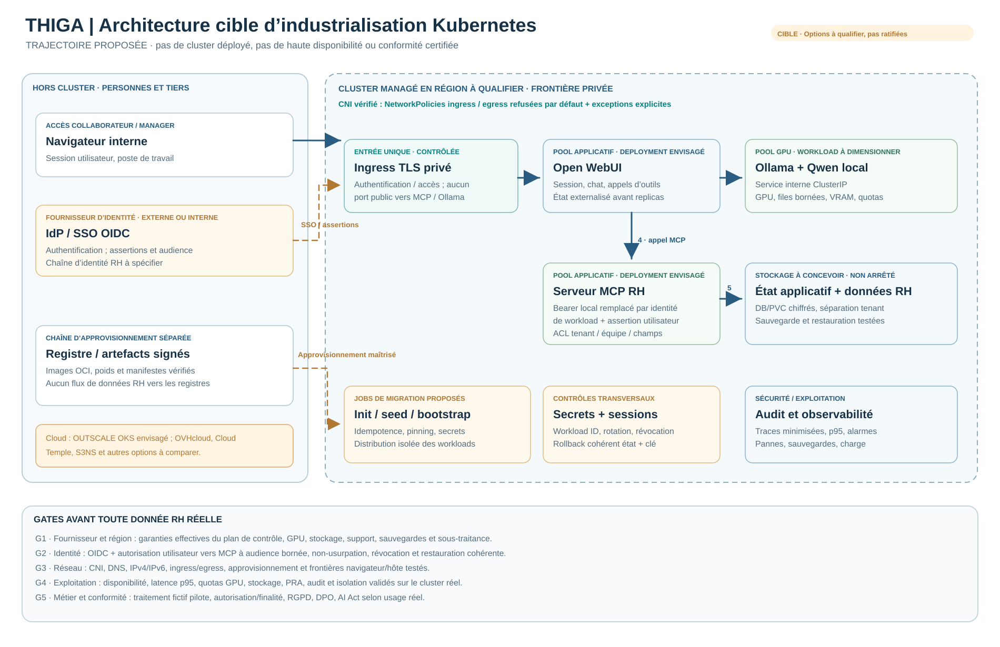

# THIGA — Architecture cible d'industrialisation Kubernetes

> **PROPOSITION NON DÉPLOYÉE.** Ce schéma répond à la question d'industrialisation posée dans l'exercice. Le démonstrateur livré et qualifié de façon bornée utilise **Docker Compose**, pas Kubernetes. Aucun cluster, CNI, ingress OIDC, pool GPU managé ou service de production n'a été testé dans cette étude.

[Voir le schéma SVG seul](architecture-cible-kubernetes.svg) · [Architecture réellement livrée](ARCHITECTURE.md) · [Étude cloud, sécurité et AI Act](PRODUCTION.md) · [Arbitrages](DECISIONS.md)

## Flux et responsabilités

1. **Utilisateur → IdP / ingress :** un collaborateur ou manager se connecte via une authentification d'entreprise (SSO/OIDC) ; l'ingress privé fournit TLS et contrôle l'accès. Le mécanisme précis d'assertion vers les services reste à spécifier et à tester.
2. **Ingress → Open WebUI :** WebUI maintient la session et orchestre le dialogue et les demandes d'outils. Sa base et ses sessions doivent être externalisées et requalifiées avant toute réplication.
3. **WebUI → Ollama :** WebUI appelle le runtime d'inférence sur un service interne de type `ClusterIP`. Ollama serait isolé sur des nœuds GPU avec limites, métriques et capacité contrôlées ; **aucun LLM cloud de secours** n'est prévu par défaut.
4. **WebUI → MCP RH :** sur le réseau privé, WebUI transmet les appels d'outils que le modèle propose ; **Ollama ne reçoit pas les droits RH et n'appelle pas directement la base**.
5. **MCP → données métier :** MCP valide la provenance de l'identité, la politique tenant/équipe/champs et les arguments avant toute lecture, puis renvoie uniquement les données autorisées. Identité de workload et assertion utilisateur à audience bornée remplaceraient le mécanisme local Bearer + UUID.
6. **Services → audit / supervision :** traces minimisées et corrélées, alertes, métriques de performance, ressources, pannes et journalisation protégée ; la journalisation ne doit pas exposer les données RH et les secrets.

## Frontières de sécurité à établir

- Ingress privé et TLS vers WebUI ; aucun port public directement vers MCP, Ollama ou les bases.
- CNI **vérifié** pour appliquer les NetworkPolicies `default-deny`, autorisations explicites entre workloads, DNS et egress strictement contrôlés. Une NetworkPolicy déclarative seule ne prouve pas le confinement.
- Séparation de la distribution des images et poids de l'inférence ; provenance, digests, signature et politique des mises à jour.
- Gestionnaire de secrets et rotation ; authentification de workload, contrôle des jetons côté MCP, révocation, sauvegarde et restauration testées.
- Préservation du risque **intention ≠ autorisation** : un utilisateur peut avoir le droit de consulter une cible sans l'avoir demandée. Les ACL ne suffisent pas à neutraliser la prompt injection.

## Échelle et choix d'hébergement

**Candidat à étudier :** 3DS OUTSCALE OKS, avec comparaison OVHcloud Managed Kubernetes et, si les services managés ne couvrent pas les exigences, une IaaS qualifiée administrée par l'organisation. **Aucun fournisseur n'est ratifié pour la production.** Les garanties doivent être vérifiées pour l'ensemble réel : cluster, plan de contrôle, GPU, réseau, bases, stockage, registre, sauvegardes, journaux, personnel et sous-traitants.

Le nombre contextuel de **500 000 comptes** ne décrit pas une concurrence de 500 000 requêtes simultanées. Le dimensionnement doit partir d'un profil de charge, de la latence p95, des quotas GPU, des coûts, de la reprise et de la disponibilité attendue.

## Portes avant toute donnée RH réelle

1. Pilote sur données fictives, vérification de la provenance et de l'identité.
2. Tests d'isolation et de sorties sur le **cluster exact**, y compris IPv4/IPv6, DNS, réseau hôte/ingress, défaillances et approvisionnement.
3. Qualification de l'agent RH, contrôle de finalité indépendant du LLM, tests positifs et négatifs, gestion des secrets et révocation.
4. Validation sauvegarde/restauration, concurrence, GPU, quotas et supervision.
5. Revue sécurité, DPO, base légale RGPD, AIPD si nécessaire, classification AI Act selon l'usage et vérification de la souveraineté contractuelle.

**Limite explicite :** le schéma est une architecture de **migration envisagée**, pas une preuve de faisabilité, de conformité, de disponibilité GPU ou de certification SecNumCloud. Les recommandations sont détaillées dans [PRODUCTION.md](PRODUCTION.md).
