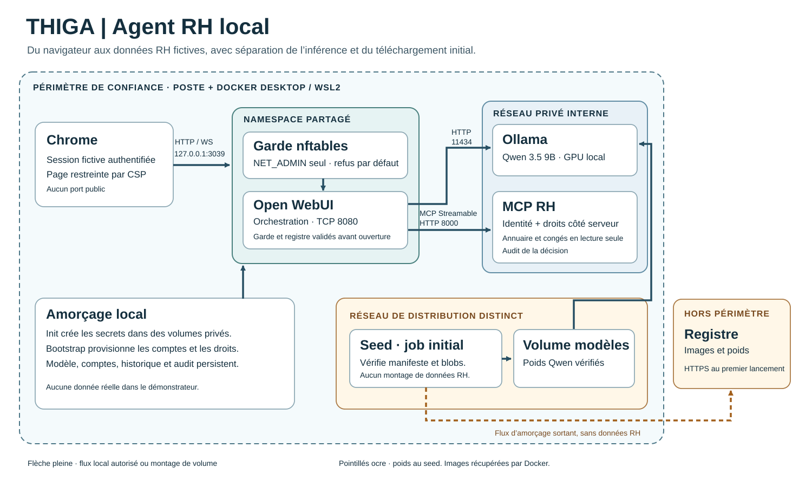

# Architecture du démonstrateur

Chrome ouvre le port `127.0.0.1:3039` sur le poste. Docker le redirige vers `8080` dans le namespace du garde que WebUI partage. Le garde seul reçoit `NET_ADMIN`. WebUI a toutes ses capacités retirées et son accès au volume du signal est en lecture seule. Le signal lie le boot, le namespace, l’identité du garde, la génération noyau et les empreintes du ruleset complet. Un signal absent, ancien ou divergent empêche l’ouverture de WebUI ou met fin à son processus applicatif.

Dans le réseau Docker privé, le backend appelle Ollama en HTTP sur `11434`, puis le serveur RH par MCP natif Streamable HTTP sur `8000`. Ollama propose les appels et produit la réponse. MCP valide le Bearer technique et mappe l’UUID de l’utilisateur WebUI vers l’acteur RH. La cible d’un appel est validée côté serveur. L’annuaire présente des champs professionnels minimaux dans l’entreprise de l’acteur. Le solde est accessible à la personne concernée et à son manager direct. `unavailable` couvre de manière uniforme le refus et la cible inconnue. Le détail de la décision reste dans l’audit.

Le seed seul rejoint le réseau de téléchargement. Il ne monte que le volume modèles et une référence publique du manifeste. Ollama, MCP et le bootstrap restent sur `private`, réseau interne. WebUI rejoint le frontal via le namespace du garde, avec une politique de sortie par défaut `DROP`. Les DNAT DNS conservent `127.0.0.11` avant le filtre et la première règle bloque cette destination. La CSP restreint les ressources et connexions de la page aux origines prévues. Le navigateur, Docker Desktop et le noyau hôte restent des frontières distinctes.

| Volume | Données et lecteurs |
|---|---|
| `admin` | Init et bootstrap, identités et secrets de démonstration. |
| `webkeys` | Init en écriture, WebUI en lecture seule, clé de session et amorçage admin. |
| `mcpstate` | Mapping et secret technique, MCP en lecture seule. |
| `audit` | Audit rotatif des décisions MCP, sans prompt ni mot de passe. |
| `webui` | Configuration, comptes, conversations, registre IAM et son témoin. |
| `models` | Poids vérifiés, utilisés par le seed et Ollama. |
| `guard_status` | Signal transitoire du garde, WebUI en lecture seule. |

Les logs permettent de relier un acteur, un outil, une décision et un identifiant de message. Les preuves de test ont ajouté le résultat fictif de l’outil et le rendu Chrome à cette corrélation. Les volumes locaux restent lisibles par l’administrateur du moteur Docker. En production, cette frontière demande des contrôles d’administration, de rotation, de sauvegarde et d’identité supplémentaires.

Le registre de révocation est validé avant ouverture de WebUI. Le logout retire les sockets du jeton visé. Le filtre, les flux RH et le profil REG-05 restent ceux de la candidate qualifiée. Voir [la portée des preuves](QUALIFICATION.md).
